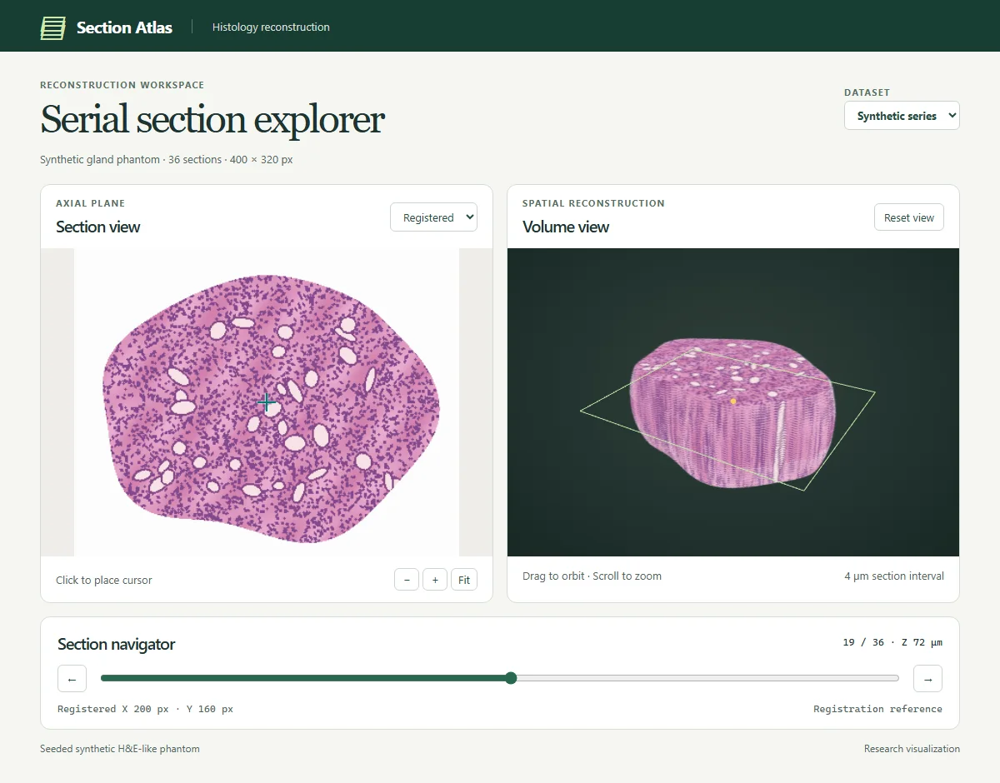

# Section Atlas · 3D histological reconstruction

Explore a series of adjacent tissue sections as a rotatable, textured stack and inspect the corresponding section in OpenSeadragon. A standalone Python command registers the images and writes the volume, transforms, QA and viewer assets. The browser reads a static export. Intended for research visualization.



## Run the synthetic demonstration

From the repository root, use Python 3.11–3.13 in a virtual environment and Node.js 22.16 or newer.

```sh
python -m pip install -r requirements.txt
python -m pipeline --output public/data/synthetic
npm ci
npm run dev
```

Open the local URL printed by Vite. Drag the stack to rotate it, move the section slider, and click in the section to locate that point in 3D. Switch between original and registered images to see the effect of registration. The 36-section phantom uses seeded acquisition offsets and known sampling.

## Run the measured pancreas series

```sh
python scripts/download_real.py
python -m pipeline --input data/real --output public/data/real --local-refinement he --name "Pancreas · 10x" --attribution "Roy, Gupta and Goswami (2023), DOI 10.17632/fzskwpzs5j.1, CC BY 4.0"
```

Select **Real histology** in the viewer. This export uses preview pixels for XY and section indices for depth. Original TIFFs and generated exports stay local. See [data provenance and ordering](docs/DATA.md).

## Inspect an export

Each output directory must be new or empty. To process your own series, pass a directory of single-frame images from one block and one magnification to `--input`. Filenames must share a pattern with one varying numeric field that supplies the order. Use `--max-side` to set the maximum preview dimension.

- `manifest.json` links each input filename to its preview, registered image and masked 3D texture. The 2-by-3 matrix maps source pixels into the rigid frame, with X increasing right and Y increasing down.
- With `--local-refinement he` (H&E color) or `--local-refinement intensity` (grayscale), each section also exports a bilinear `pullGrid` sampled across the registered image, including both endpoints. At registered pixel `p`, the corresponding rigid-frame point is `p + grid(p)`. Section images, 3D textures and the linked cursor use the same mapping. Omit the flag to reproduce rigid registration.
- `volume.npz` contains registered RGB samples in Z,Y,X,channel order and separate tissue and valid-pixel masks in Z,Y,X order. The mask uses color thresholds. It can include artifacts and miss pale tissue.
- Registration searches for adjacent translations, refines them with bounded rigid rotation, and composes accepted transforms toward the middle reference section. Inspect the status and before/after correlation of each pair. An identity fallback inherits the fixed section's transform. Chaining can accumulate drift, and rigid registration cannot correct tears or local distortion.
- The 3D display samples the section planes. Missing tissue between samples, anatomical boundaries and physical depth require independent evidence.

Render ten evenly distributed adjacent overlays for review. Red and cyan fringes indicate differences between neighboring sections.

```sh
python scripts/review_pairs.py public/data/real/manifest.json data/real-review.png
python scripts/landmark_error.py public/data/real/manifest.json docs/pancreas_landmarks.csv
python scripts/landmark_error.py public/data/real/manifest.json docs/pancreas_check_landmarks.csv
```

## Verify and build

```sh
python -m unittest discover -s tests
npx playwright install chromium
npm run test:e2e
npm run build
npm run preview
```

Generate the synthetic export before running browser tests. The real-series test also runs when its export exists. Build after generating the datasets you want to serve. The static output is in `dist/`.

The pipeline holds preview arrays in memory and the viewer loads downsampled textures. Whole-slide ingestion, tiled multiresolution export and chunked 3D access are future work. The [POC plan](docs/POC_PLAN.md) describes the path to larger series and the proposed independent landmark validation.
