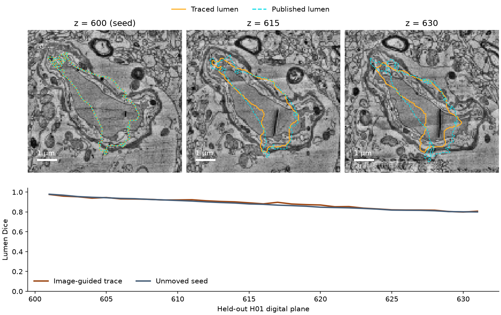
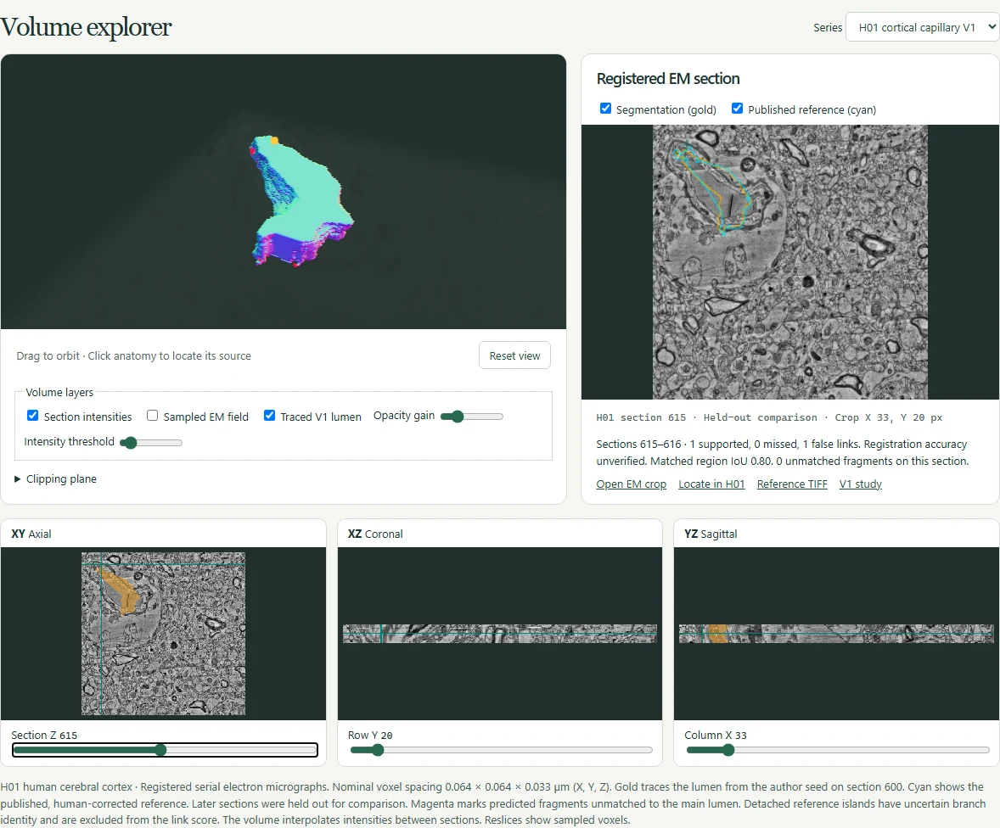

# Tracing one human cortical capillary through serial EM

**The published lumen of capillary V1 can be followed across 32 consecutive registered H01 image planes.** Starting with the author's label on plane 600, the image-guided trace localized the main lumen on every subsequent plane through 631. An unchanged copy of the first outline also retained that connectivity. This is evidence for the identity and local continuity of this vessel segment. Its short, nearly axial course makes it a weak test of tracking accuracy and provides no positive test of bifurcation recovery.

### Specimen and independent evidence

Shapson-Coe et al. imaged human temporal cortex by serial-section electron microscopy. Vanderleest and Arboleda-Velasquez studied three identifiable capillaries in that registered volume, corrected their segmentations while scrolling through the sections, and deposited the per-plane tissue classes. We took the first 32 planes of their first vessel in publication order. This fixes the window independently of our reconstruction's score. The study authors selected vessels oriented along depth. They provided the external anatomical review used here. We did not commission a second reader or a new blinded adjudication. [H01 acquisition](https://doi.org/10.1126/science.adk4858) · [Vessel study and annotation methods](https://doi.org/10.3389/fcell.2026.1788958) · [S-BIAD3187 reference labels](https://www.ebi.ac.uk/biostudies/bioimages/studies/S-BIAD3187)

We also acquired and opened 20 calibrated CODA lung images. Published annotations within that particular sequence cover only its first image. H01 provides a biological lumen identity and an independent boundary on every image in the selected window. Results below apply to serial EM of cortex. Transfer to lung H&E or to unregistered optical slides remains untested. [CODA acquisition record](CODA_LUNG.md)

### Geometry and reconstruction

The measured channel comes from the registered H01 release. We used the authors' extraction coordinates, level-zero X in [499600, 504000), Y in [350000, 354400), and digital Z from 600 through 631. Mean intensity over each 16 × 16 native pixel block gives a 275 × 275 display image. The native raster has nominal 4 × 4 × 33 nm spacing and the export uses 64 × 64 × 33 nm. The distance between first and last plane centers is 1.023 µm on this grid. H01 reports variable section thickness, tissue compression during cutting and some repeated section representations. We verified distinct image content at all 32 indices. Individual physical-cut IDs and thicknesses in this interval remain unverified. The displayed aspect ratio describes the released grid. [Authors' extraction code](https://github.com/timvanderleest/Vessel-Ultrastructure-Analysis/blob/main/DownloadH01VesselRawImages/main.py) · [H01 release and calibration](https://h01-release.storage.googleapis.com/data.html)

Class 4 in the published TIFF denotes lumen. A display voxel receives that label when more than half its native pixels are lumen. The author mask at z=600 initializes a signed distance field. Backward optical flow between adjacent measured planes transports that field to each next plane. The frozen tracker accepts only the images and initial mask. It receives no later reference masks, interpolates no missing planes, and stops carrying a label after a blank plane. The mesh triangulates the predicted voxel boundaries. The image viewer interpolates RGB for display. The author reference includes manually corrected algorithmic labels.

### What counted as a connection

The reference task is to follow the principal lumen of the authors' named V1 vessel. Each reference section has one dominant four-connected component. An expected link joins that component to V1 on the next referenced plane. This reference graph is our operational interpretation of the authors' region and vessel identity. The archive supplies no separately annotated edge list. All 278 reference voxels on detached islands remain in the contour display and Dice calculation; their branch identities are unresolved.

We used one-to-one assignment and a primary in-plane intersection-over-union (IoU) cutoff of 0.50 to match predicted regions to the reference target. A predicted inter-plane link requires at least one shared voxel face. All predicted components enter the graph score. Links involving unmatched fragments count as false relative to the **principal-lumen task**. They can include genuine small lumen regions, rasterization artifacts, or tracking errors. The viewer highlights unmatched fragments in magenta. Branches in the cropped mesh terminate at the crop limits.

| Measurement | Result |
| --- | ---: |
| Main-lumen matches on held-out planes | 31 / 31 |
| Supported / missed principal-lumen links, including the step from the seed | 31 / 0 |
| Extra cross-plane links relative to the reference graph | 21 |
| Extra split / merge events | 5 / 4 |
| Reference bifurcations in this interval | 0 |
| Held-out voxel Dice, across planes 601–631 | 0.8858 |
| Held-out voxel Dice, unmoved-seed baseline | 0.8789 |
| Worst single-plane Dice, z=630 | 0.7989 |

The unmoved seed also recovered 31 of 31 principal links. Tightening the IoU threshold to 0.75 leaves **20** supported links; at 0.90 only **3** remain. These are boundary-sensitive matching results on the same evidence. The correspondence is stronger than the boundary estimate. Removing the prediction on plane 616 in a regression test loses the two expected neighboring links. No sample-size-based confidence interval is justified by correlated slices from a single vessel. [Per-plane and per-link evidence](../public/capillary/validation.json)

### Registration and source inspection

Both image and reference use the H01 registration. Agreement between them cannot establish absolute registration accuracy. We spot-checked two features outside the seeded lumen on each of three adjacent pairs (606/607, 620/621, 630/631). The six manually estimated displacements ranged from 0 to 2 display pixels, within the exploratory four-pixel tolerance. Three local checks passed, none failed, and 28 intervals have unknown registration accuracy. True biological change and pointing error both contribute to these distances. Horizontal image bands and changing ultrastructure are visible in the crops. Exact displacement, physical shrinkage and microscopic branches below display resolution remain unresolved. [Landmark coordinates](h01_local_checks.csv)

Choose **H01 cortical capillary** in the volume explorer, or open the app with `?dataset=capillary`. Select the mesh to see the registered EM crop with the traced and published contours, section number, matched-region IoU, and next-pair evidence. Links open the measured crop, its native H01 location, and the exact original annotation TIFF. The packaged PNGs reproduce the area-averaged registered raster and carry no baked-in overlays.

### Reproduction and attribution

From the project root, install the normal Python requirements plus TensorStore for the optional remote fetch. The local exports already contain all inputs needed to inspect the results. Rebuilding the upstream input cache requires public network access. The TIFF downloader checks each retrieved file against its recorded SHA-256. The expected SHA-256 of the uint8 ZYX EM pixel buffer is `4a000879e38c126579dc0c3f821e58ac11ec37f748b86f1f504643d8d7809874`.

~~~sh
python -m pip install -r requirements.txt tensorstore
python scripts/download_h01_vessel.py
python scripts/download_h01_labels.py
python -m pipeline.h01
python -m unittest discover -s tests
npm run build
npm run preview
~~~

To regenerate the report figure from the packaged assets, install Matplotlib and run `python scripts/capillary_report_figure.py`. The H01 imagery is by the Lichtman laboratory and Connectomics at Google, distributed under CC BY 4.0. The bundled images are cropped and downsampled. The lumen reference derives from Timothy Vanderleest and Joseph Arboleda-Velasquez's deposited class labels. The archive record inspected for this work lists no individual data license; the BioImage Archive states its default redistribution terms in its FAQ. [H01 data license](https://h01-release.storage.googleapis.com/data.html) · [CC BY 4.0](https://creativecommons.org/licenses/by/4.0/) · [BioImage Archive reuse terms](https://www.ebi.ac.uk/bioimage-archive/help-faq/)
