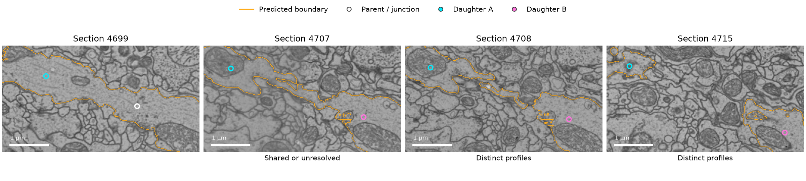
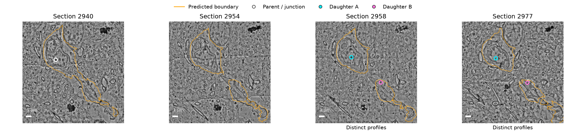

# Two daughters of a real branch point

**A manually traced neuron in the adult fruit fly provides a positive bifurcation case.** A surface reconstructed from a separately published automated segmentation follows both identified daughters through consecutive EM sections. One parent region directly touches two different daughter regions at the transition from section 4707 to 4708. Both daughters remain separate through section 4715.

A second experiment follows two vascular profiles in human cortex. Its source-only reader could distinguish the profiles for 20 planes but could not resolve the intervening junction. The two experiments support different anatomical claims. [Vascular fork report](H01_VASCULAR_FORK.md)

## Inspect the branch

Open the app with `?dataset=bifurcation` or select **FAFB neuronal bifurcation**. Use **Daughter A** and **Daughter B** to move the linked cursor between independent reference points in the same section. The gold contour comes from the automated mask. The lettered rings mark manual centerline coordinates. **Native EM location** opens the selected location in the upstream image volume, and **Nearest traced node** opens the corresponding CATMAID node. The original PNGs contain grayscale measurements with no overlays.

## Specimen, reference and selection

The Full Adult Fly Brain (FAFB) dataset contains registered serial-section transmission electron microscopy of an adult female *Drosophila melanogaster*. We selected a branch of the neuron named **Uniglomerular mALT VA6 adPN 017 DB**, CATMAID skeleton 16. Manual node **780** has two children, **835** (A) and **781** (B). The ground truth for the local branch identity consists of these human-traced node and parent relationships. It contains no independent membrane outlines. [FAFB acquisition paper](https://doi.org/10.1016/j.cell.2018.06.019) · [Open the manual branch point](https://fafb.catmaid.virtualflybrain.org/?pid=1&active_skeleton_id=16&active_node_id=780)

Before inspecting the segmentation, we screened the human tree for bifurcations whose incoming and outgoing paths progressed in a common Z direction through successive planes. Within skeleton 16, 34 candidates met the minimum of two parent-plane steps and five daughter-plane steps. We ranked by available uninterrupted depth, capped at eight parent and sixteen daughter steps, then by distal in-plane daughter separation. Node 780 ranked first, with 4.54 µm between its distal daughter points. This preferentially selects an identifiable fork. It gives no population-level estimate of branch detection.

The reference has actual node observations on each selected plane. We checked all **42 nodes and 41 edges** against a public 2019 skeleton archive predating the April 2020 segmentation release. All edges had matching archived endpoints, with maximum vertex displacement 28.25 nm. The reference determined the target and crop. Only the first parent point determined which predicted instance to reconstruct. Daughter points never enter mask extraction or meshing. They are independent observations for this reconstruction; upstream training-set exclusion for this particular crop was not verified. [Archived skeleton](https://storage.googleapis.com/fafb-ffn1/fafb-public-skeletons/16) · [Reference coordinates and node IDs](../public/bifurcation/trace.json)

## Reconstruction and connectivity test

1. Retrieve EM and the FAFB flood-filling network (FFN) segmentation on the same 331 × 179 × 25 grid, covering **4691–4715 inclusive**. Display sampling is 16 × 16 × 40 nm. The release has 4 × 4 nm native XY pixels. The crop starts at native XY (109124, 33552); each display-plane index corresponds directly to one released Z index. CATMAID lists no broken section in this window. Absolute local registration error and actual cut thickness have no independent measurement here. [Image and segmentation release](https://fafb-ffn1.storage.googleapis.com/data.html)
2. Read FFN instance **710435991** at the proximal parent point. Keep the 3D face-connected component of that ID containing the seed. Three disconnected voxels are excluded. Triangulate its exposed voxel faces for the surface. The predicted identity and boundaries come from the published FFN segmentation; this experiment recomputes the connected reconstruction and evaluates it. [Reconstruction and scoring](../pipeline/fafb.py)
3. Independently map each manual node to its containing voxel. In each plane, label four-connected predicted regions. An edge from one plane to the next requires face contact. For each daughter, check point membership, the actual manual parent edge, and a forward path from the original seed. Require two distinct daughter regions to share faces with the **same** parent region at the split. Occupancy alone cannot pass this test. [Per-plane and per-edge evidence](../public/bifurcation/validation.json)

## Results and controls

| Measurement | Daughter A | Daughter B |
| --- | ---: | ---: |
| Manual points inside prediction and reachable from seed | 17 / 17 | 16 / 16 |
| Manual parent edges supported | 17 / 17 | 16 / 16 |
| Consecutive planes with both daughters spatially distinct | 8 / 8 | 8 / 8 |
| Consecutive links while the two daughters remain distinct | 7 / 7 | 7 / 7 |
| Own distal points lost when only that daughter is removed | 8 | 8 |
| Other daughter's points lost in the same experiment | 0 | 0 |

The human centerline branches on plane 4699. Child A has a node on that same plane, which accounts for its additional point and edge. Both daughters have individually traced points on **all 16 planes from 4700 through 4715**. From 4700 through 4707 their points occupy a common predicted profile. At **4707→4708**, parent component 1 contacts A's component 1 and B's component 3 on the next section. Component numbers are local to each plane.

A stationary copy of the first mask contains **all 33 daughter points** but produces **zero** spatially resolved daughter planes and **zero** supported splits. Independently removing either distal daughter from the reconstruction also eliminates the split while preserving the other arm's point and edge scores. These controls distinguish recovery of both branches from mere containment of the reference coordinates. [Regression tests](../tests/test_fafb.py)

Within the crop, 39 additional predicted adjacent-region links have no corresponding adjudicated manual edge. The sparse reference cannot distinguish incidental profile divisions from false connections on those links. It cannot measure boundary Dice, exclude a missed side branch, or establish the exact physical location where two membranes separate. The 9-plane offset between the centerline junction and the first resolved cross-section is reported directly. Finite process width, section orientation, registration and segmentation can all affect that offset.

## Vascular comparison

The H01 vascular candidate uses a different evidence chain. A low-resolution human vascular atlas supplied coarse branch identity; an archived tissue model supplied a predicted whole-vessel profile. A separate AI visual reader saw measured EM only and withheld 15 ambiguous transitional planes. On sections **2958–2977** both independently marked profiles are present and separate in the prediction. Each daughter has 20/20 point hits and 19/19 adjacent same-arm links. Ten distinct 66 nm prediction slabs underlie those 20 measured 33 nm planes. The reader did not establish lumen patency or a human-adjudicated native-plane fork. [Measured images, uncertainty and reproduction](H01_VASCULAR_FORK.md) · [Frozen reader annotations](vascular-fork-reader/annotations.csv)

## Reproduce the named neuron experiment

Use Python 3.11–3.13 and run the following commands from the project root. The checked-in viewer bundle includes the image crops, mesh, trace and validation JSON. Public network access and TensorStore are needed to reacquire the source arrays. The machine-readable report records the EM, instance raster and historical skeleton SHA-256 digests for comparison across exports. The fixed crop and endpoint IDs are in the acquisition script.

~~~sh
python -m pip install -r requirements.txt tensorstore
python scripts/download_fafb_bifurcation.py
python -m unittest discover -s tests -p test_fafb.py
npm ci
npm run build
npm run preview
~~~

To regenerate both evidence figures, install Matplotlib and run `python scripts/bifurcation_figures.py`. Commands for the H01 case and the full test suites are in the [vascular case report](H01_VASCULAR_FORK.md#reproduce-and-inspect) and [project guide](PROJECT_GUIDE.md).

**Attribution and reuse.** The grayscale crops are downsampled derivatives of the FAFB imagery of Zheng, Lauritzen and colleagues, distributed under CC BY-NC 4.0. The centerline comes from the Zheng et al. collection via Virtual Fly Brain CATMAID. The mask and mesh are derivatives of Li et al.'s FAFB-FFN1 April 2020 automated segmentation. Its release describes use for neuroscience and image-processing research. The image license applies to the image layer; consult the respective sources for reuse of the trace and segmentation. [TEMCA data terms](https://www.temca2data.org/) · [CC BY-NC 4.0](https://creativecommons.org/licenses/by-nc/4.0/) · [VFB collection context](https://www.virtualflybrain.org/docs/past-workshops/connectome/3_visualisation/) · [FFN release](https://fafb-ffn1.storage.googleapis.com/landing.html)
