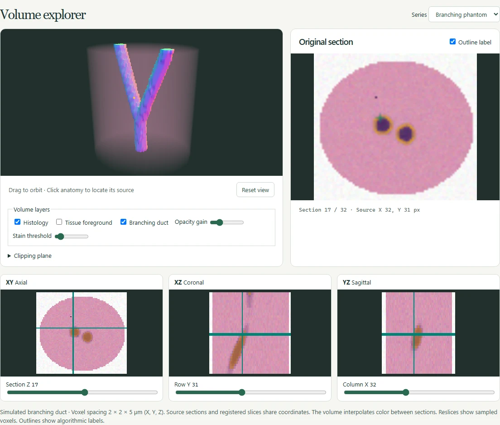

## Volumetric reconstruction milestone

The volume explorer opens on a simulated duct sampled on 32 sections. Click either arm of the 3D surface. The source panel opens the original section, traces the segmented region, and marks the selected voxel. Click an orthogonal reslice or move a slider to follow the duct through the split. Histology, foreground and the segmented surface have independent visibility controls. Adjust the stain threshold and opacity gain or move and rotate the clipping plane to inspect the interior. The original plane-stack explorers remain below.

### What the phantom establishes

The source generator uses a known Y geometry, simulated blur, stain noise and dark specks. The segmentation step reads the generated PNGs, thresholds green intensity and removes small planar components. It receives no reference labels. Face-sharing regions on adjacent slices form the connectivity graph. Each exposed voxel face produces two indexed mesh triangles. The voxel-center transform includes the synthetic grid spacing of 2 × 2 × 5 µm in XYZ order.

| Test | Reference | Recovered |
| --- | --- | --- |
| Roots and terminal regions | 1 root, 2 tips | 1 root, 2 tips |
| Parents with two children | 1 on section 15 of 32 | 1 on section 15 of 32 |
| Merges | 0 | 0 |
| Volumetric overlap | Reference binary raster | Dice 0.9923 |

Deleting both labeled regions on section 21 introduces two new roots on the following section. This negative control detects lost continuity even when most voxels agree. The fixture is already aligned and the stain contrast was designed for this experiment. The result validates recovery of this topology under those conditions. Branch geometry in a new stain, registration under tissue loss and topology on biological specimens require separate tests.

### Pancreas experiment and uncertainty

The RGB display volume uses all 36 registered Roy pancreas previews downsampled fourfold in XY to 160 × 120. Original slide previews remain at 640 × 480. The source outline maps voxel boundaries back through the local displacement field and inverse rigid transform. A digest binds the reconstruction to its registration manifest.

The exploratory rule finds bright cavities of 4–160 display pixels surrounded by darker pixels within the valid field. Among components sharing faces on consecutive sections, it selects the one spanning the most sections, breaking ties by voxel count. The resulting candidate occupies 620 voxels on sections 6–15, with a surface of 2,884 triangles. Glass, tears, ducts, vessels and other pale structures can all satisfy parts of this rule. Selection for longest persistence biases the result toward apparent continuity. This series has no verified duct labels. Foreground is a separate stain-derived mask. Pancreas material is derived from Roy et al., Mendeley Data v1 (2023), CC BY 4.0. [Acquisition, attribution and registration history](DATA.md)

Three new image landmarks were chosen on original paired previews after freezing registration. Pairs 7/8, 12/13 and 26/27 were inspected without registered overlays. Pair 12/13 was set aside because correspondence was ambiguous. The points are independent of transform fitting and selection, with a single nonexpert annotation pass. They measure adjacent registration residuals, not anatomical label accuracy or cumulative drift.

| Pair and feature | Source separation (preview px) | Registered separation (preview px) |
| --- | ---: | ---: |
| 7/8 lower left lobule crown | 23.6 | 8.4 |
| 26/27 horizontal band end | 125.3 | 23.1 |
| 26/27 upper margin at cleft | 98.7 | 10.8 |
| Mean | 82.6 | 14.1 |

Source previews contain measured stain after downsampling. Registered previews resample those measurements after alignment. The GPU uses trilinear interpolation for the displayed RGB and foreground opacity between retained planes. A mesh describes the segmentation boundary on the sampled grid. None of these operations measures the space between cuts. Missing cuts can break a real branch or make distinct regions appear connected. The pancreas images lack calibrated XY and cut interval, so all three axes use display indices and support no physical length or volume estimates. This workflow uses no AI-predicted samples.

### Reproduce

From the repository root, install the Python requirements and generate the real export with the command in DATA.md. The following commands regenerate the browser assets and score the held-out points. JSON reports beside each export contain the measured results. RGB bytes are interleaved in Z,Y,X,channel order. Labels are uint8 in Z,Y,X order with 0 for background, 1 for tissue and 2 for the displayed structure. Mesh coordinates are XYZ in voxel-center units with half-integer boundaries.

~~~sh
python -m pipeline.branching public/branching
python -m pipeline.pancreas public/data/real public/pancreas
python scripts/landmark_error.py public/data/real/manifest.json docs/pancreas_frozen_landmarks.csv
python -m unittest discover -s tests
~~~

### Calibrated serial-section acquisition

BigBrain is a candidate for an independent calibrated experiment. The project reports a nominal 10 µm in-plane scan and 7,404 coronal sections cut at 20 µm. Its reconstructed grid is 20 µm isotropic. Raw acquisition, distributed section derivatives and reconstructed volumes therefore require distinct spacing metadata. A practical acquisition starts with DataLad selective retrieval of consecutive raw sections and their identifiers. Inspect the delivered image headers, downsampling and repair records before assigning spacing, then carry that calibration through cropping and resizing. The atlas can provide an external spatial comparison, while its repair and registration history limits its use as ground truth. This PR does not distribute BigBrain material. [Acquisition methods](https://bigbrainproject.org/about.html) · [Raw dataset and retrieval instructions](https://github.com/conpdatasets/BigBrain_Raw_Data)
