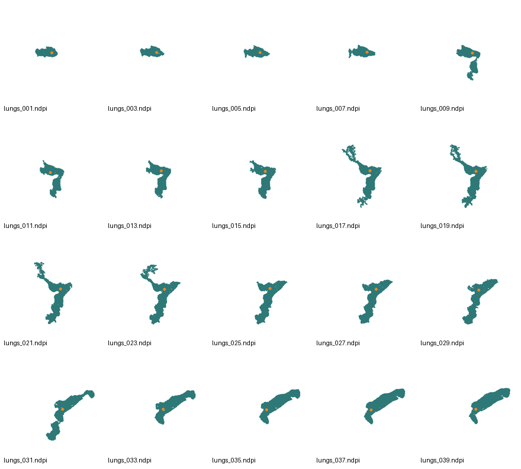

# Following a bronchiole through 20 lung H&E slides

The airspace inside CODA lung bronchiole region 3 can be followed from `lungs_001.ndpi` to `lungs_039.ndpi`. These are 20 retained H&E slides at nominal 10 µm intervals, spanning 190 µm between the first and last slide centers. The publisher identifies the bronchiole on slide 001. Its identity on the other 19 slides is a working correspondence. [Acquisition, calibration and source files](../CODA_LUNG.md)



Each tile has the same orientation and field of view, approximately 2.26 mm wide in the first slide's frame. Green shows the estimated airspace. Orange is one lumen point placed by an AI reader in that slide's native image. At 007–009, the outline expands into an adjacent profile. At 017–023 it includes fine peripheral airspaces. Slide 031 also has a variable distal extension. Treat those extensions as uncertain. The orange points follow the interior of the selected profile. They do not validate the entire green boundary or identify a bifurcation.

## Evidence for the trace

The seed was the largest publisher-labeled bronchiole region by XML area on slide 001. Local tissue registration brought the surrounding neighborhood into view on each later scan. An AI reader inspected the unoutlined H&E crops in order, using the epithelial wall, lumen shape and surrounding tissue to place one point per slide. Those coordinates were recorded before running the segmentation. The reader saw registration-guided crops and knew the seed identity. Independent pathologist review is outstanding. [Native slide coordinates](bronchiole-3.csv)

The algorithm uses the first XML polygon and slide pixels. It fits rigid transforms between neighboring slides using local tissue features, thresholds the pale airspaces, and chooses the connected component with the highest overlap with the preceding registered mask. The initial component overlaps the publisher polygon at IoU 0.501. The polygon covers only part of the connected pale space visible on 001. The later points enter only during scoring. [Reconstruction and scoring code](../../scripts/trace_coda_lung.py)

| Check | Observed in this window |
| --- | --- |
| Source landmarks inside the reconstructed profile | 20/20, including 19/19 after the seed slide |
| Landmarks inside the first reconstructed mask transported by the same registration | 9/20, including 8/19 after the seed slide |
| Adjacent retained pairs sharing profile voxels after registration | 19/19 |
| Connected components in the exported browser mask | One using face connectivity, containing all 20 source points |
| Weakest overlap with the preceding registered profile | IoU 0.4791 at 007–009 |

The overlap test favors continuity by construction. A positive point test can also survive an overlarge mask. These checks support a trace of the lumen interior, while leaving false peripheral connections, membrane accuracy and the unsampled cuts unresolved. Registration used as few as nine feature inliers on some intervals. They are fitting observations. Independent registration landmarks and deformation measurements would be needed to quantify positional error. [Per-slide audit](audit.csv)

## Reproduce and inspect

From the repository root with Python 3.11 or later and Node installed:

```sh
python -m pip install -r requirements.txt openslide-python openslide-bin
python scripts/download_coda_lung.py
python -m scripts.trace_coda_lung
npm ci
npm run dev
```

Open the local URL printed by Vite with `/?dataset=coda-lung`. Select a point on the mesh or step through the sections. The source panel maps the selection back to its NDPI filename and level-zero pixel coordinates. Toggle the gold mask and orange point to inspect the measured image beneath them. The volume samples registered tissue at about 14.13 µm in XY. The native crops sample at about 3.53 µm, and the scanner tags give about 0.442 µm per level-zero pixel. The Z interval is nominal. Section thickness variation, inter-cut tissue and cumulative drift remain unmeasured.

The export writes the source crops, individual masks, `source-audit.jpg`, numeric transforms, a labeled volume and a voxel surface under `public/data/coda-lung/`. The surface shows estimated airspace, with a slab assigned to each retained section. The local viewer interpolates stained intensities between planes. The public repository includes derived outlines, point coordinates and scores. Regenerate the image-backed case locally because image redistribution terms are unresolved. To run the checks with the local case present, use `python -m unittest discover -s tests` and `npm run test:e2e`.
