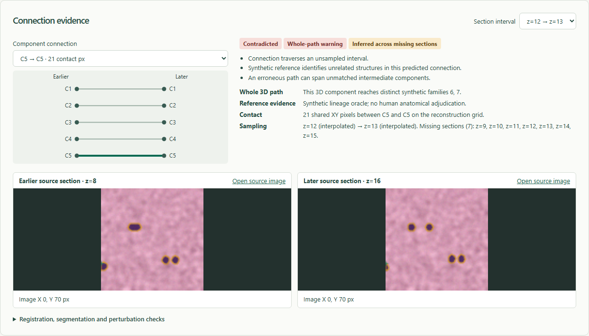

# Inspect a reconstructed connection

Open the volume explorer and choose **Seven missing sections**, or append `?dataset=field-gap` to the app URL. The initial link is inside an interpolated interval. Its mask shares 21 XY pixels across the selected pair of grids. The synthetic lineage reference shows that the full connected volume joins a departing structure to an unrelated entrant. Whole-volume Dice is **0.948410** with identity alignment. Only sections 8 and 16 supply source images for this interval.



Click the warning above the volume to reach **Connection evidence**. Choose a section interval, then click a line between components or use the connection selector. Tab and Enter also select a graph edge. To pick a specific contact in Three.js, enable **Pick 3D contacts on this interval** and click its cyan marker. Clicking a mesh surface selects the nearest incident connection on that voxel's planar component, when one exists. The paired source panels show the two reachable sampled flanks, their segmentation boundaries, coordinate readouts and image links. A missing flank has no source witness. A cursor on an interpolated plane has no source image.

## Reading the evidence

| Signal | Evidence and scope |
|---|---|
| Observed geometric contact | Two segmented components share at least one registered XY voxel face on adjacent sampled grids. Section images are measurements; the masks and their contact are computed. A normalized TCIA plane can have a measured image and an interpolated, failed tumor mask simultaneously. |
| Inferred interval | Missing grid positions or documented intervening cuts separate the measured flanks. The record lists their IDs and follows directed mask contacts to a representative witness on each side. Multiple reachable branches can exist. The displayed coordinates identify one witness on each flank. |
| Alignment-sensitive | Translating the later component map by two grid pixels in at least one cardinal direction eliminates this specific contact. The inspector gives all four resulting areas. Pixel offsets are in the reconstruction grid and are not calibrated registration confidence intervals. |
| Boundary-sensitive | One cross-shaped pixel of erosion on both planes removes the contact or divides an endpoint, or dilation fuses an endpoint with a separate neighbor. The dilation control also records a fusion demonstrated by comparison with the same seed before boundary expansion. |
| Independently verified identity | A separately traced **FAFB manual centerline arc** witnesses this specific pair of components. The skeleton and node IDs identify the evidence. Membrane outlines and the whole path have separate uncertainty. H01 V1 mask agreement supports the operational principal-lumen comparison; it does not supply an independently annotated edge. |
| Contradicted / whole-path warning | The controls use known synthetic family IDs. A six-connected predicted component that covers at least 25% of a cross-section from each of two distinct families triggers a whole-path warning, including on links passing through unmatched intermediates. A local contradiction requires an endpoint fusion or incompatible families on its reachable flanks. A contradiction on one link does not automatically contradict every local link in the volume. |
| Unresolved | No scoped independent evidence establishes this identity. For real specimens the graph reports whole-path identity as unresolved and describes sensitivity or gaps anywhere on the same connected component. A stable perturbation result, high Dice, high correlation or agreeing reconstructions cannot set the verified flag. |

## Demonstrated controls and heuristic limits

The controls reproduce seed 11 of the [frozen PR #11 study](../robustness/README.md) with correct alignment. **Field-gap** demonstrates a false path through unmatched intermediate regions across seven missing sections. **Fold** adds a dark ribbon that joins two independent families on sampled planes. **Boundary dilation** expands measured masks by one pixel and joins those neighbors. **Uncertain branch depth** reconstructs a split between z=10 and 11; the synthetic oracle places it between 9 and 10, while measured sections 8 and 12 bracket the transition. The synthetic oracle is withheld from segmentation and is available only for evaluation.

For measured specimens, sensitivity flags describe actual numerical changes in these limited probes. Interpreting those changes as a biological error is heuristic. Anatomy can vary within a sampled interval, coherent drift can survive a local test, and an overlarge mask can survive every shift. The 25% coverage rule is a simulator diagnostic. There is no dense family oracle in the measured H&E studies. The CODA publisher outline identifies only the seed. **CODA remains REVIEW PENDING.** The frozen TCIA contours evaluate extent on C and E and do not adjudicate continuity between levels.

## Data contract and reproduction

Each JSON graph contains ordered section IDs and sampling status, graph-wide registration and segmentation methods, and the ordered alignment offsets. Edge IDs are `z:earlierComponent>laterComponent`. Component numbers are local to their section. Each edge records its two registered XYZ contact voxels, number of shared XY pixels, source flanks and missing section IDs, perturbation counts, flags and reasons, 3D connected-component ID, path risk and source of reference evidence. Measured specimen exports also carry the native coordinate frame and XY coordinates. The cursor in a native image uses pixel-edge coordinates. The viewer checks SHA-256 of the classification volume and line-ending-normalized manifest before it displays the graph.

From the repository root:

```sh
python -m pip install -r requirements.txt
python -m scripts.connection_controls
python -m scripts.export_connection_evidence --roy-manifest dist/data/real/manifest.json
python -m unittest discover -s tests
```

The public graphs and synthetic controls are checked in. Run `npm ci` and `npm run build` first to obtain the pinned Roy registration manifest in a clean checkout. Rebuild after regenerating assets. `npm run test:built` checks the production bundle. `npm run test:e2e` exercises local development, including optional local source exports.

For CODA, [generate the source export locally](../coda-lung/README.md), then run `python -m scripts.export_connection_evidence --case coda-lung`. This writes `connections.json` inside the ignored local case folder. The static installer excludes this folder. Real independent reader files can be attached locally using the [blinded import protocol](../coda-lung/ANNOTATION_IMPORT.md) and the same frozen scoring code:

```sh
python -m scripts.export_connection_evidence --case coda-lung --review-manifest data/coda-review-manifest.json --reader data/A.geojson data/A-edges.csv --reader data/B.geojson data/B-edges.csv
```

Reader comparisons retain individual IDs, reviewed/excluded status, profile assignments and verdicts for each contact. Credentials and blinding require coordinator verification. The exporter keeps these comparisons unadjudicated; no majority vote or metric automatically verifies a CODA edge. This release contains no returned pathology readings.
