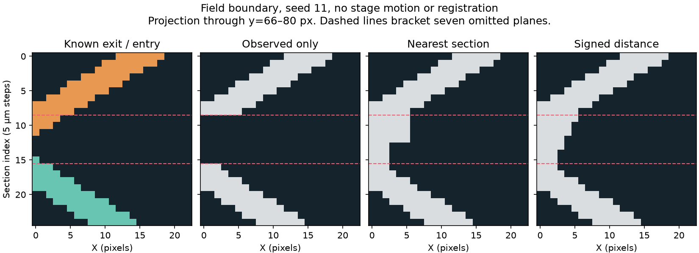
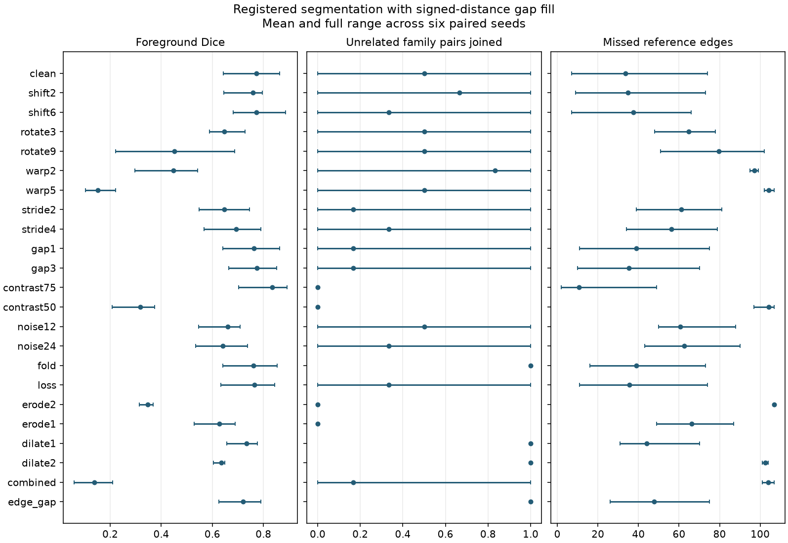
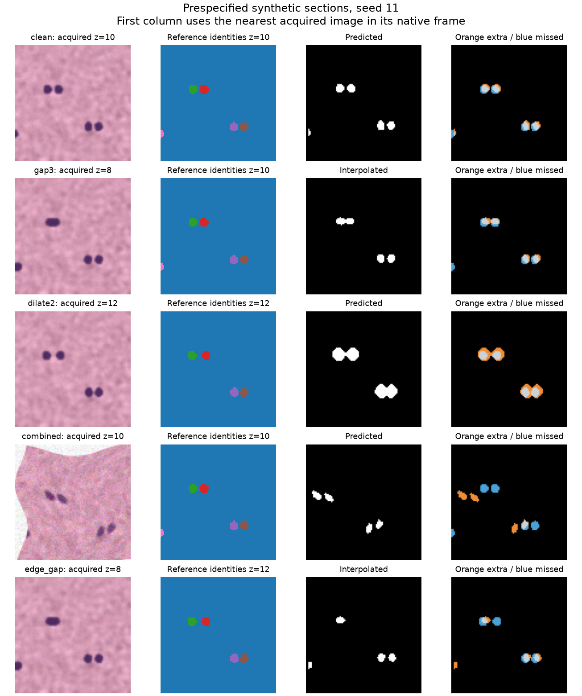

# When does a reconstructed connection deserve a warning?

Seven missing sections were enough to join two unrelated lumens in **all six synthetic blocks**. One lumen left the field and a different one entered at approximately the same XY location. With correct alignment, signed-distance interpolation achieved mean whole-volume Dice **0.948** (seed range **0.946–0.952**) while creating the false path every time. A fold produced a second failure mechanism: the segmentation bridged two neighboring lumens on four measured planes in every block, even though Dice averaged **0.982**. An image-quality gate and a gap warning address different errors.



The colors in the reference identify different structures. White denotes predicted foreground. The longitudinal projection illustrates the field boundary; connectivity was calculated on the full 3D grid. The gap is 40 µm between observed section centers in this simulation.

## Experiment

We fixed the [design](PROTOCOL.md) before execution. Six seeds vary subpixel anatomy, image texture, acquisition pose and noise around the same known topology. The 96 × 96 × 25 grid has 2 µm XY spacing and 5 µm dense Z sampling. A parent splits at section 10 (zero-based); two other lumens approach within about 1.4 px at their closest centerline transect; two further identities leave and enter the field. Analytic profile identities and lineage supply 107 reference edges per dense block. Rendering adds optical blur and stain texture. Methods receive RGB and retained indices only.

The 23 configurations include separate translation, rotation, sinusoidal deformation, noise, stain, dark fold, white tissue-loss patch, boundary erosion/dilation and sampling perturbations, one combined stress test, and the field-boundary gap. A stride of 2 or 4 samples at 10 or 20 µm. Boundary offsets apply planar four-neighbor morphology to the segmented anchors. Each seed is paired across all configurations, both registration settings and five methods. The measured-only, nearest and signed-distance masks coincide when every plane is available. All 1,380 runs are retained, including these ties and failed predictions.

* **Registration and segmentation.** Use the project's pairwise translation candidates and bounded rigid ECC estimator, composed to the first retained image. The ordinary application uses a middle anchor. The ablation uses identity transforms. Apply the existing branching-phantom intensity and component-size rules on aligned images. The injected nonlinear warp tests the limits of the rigid estimator. Local-refinement algorithms were outside this comparison.
* **Reconstructions.** Segment each observed plane and leave missing masks empty; repeat the first segmented mask in registered space; propagate that initial mask with the project's image-driven capillary optical flow; copy the nearest segmented section; or interpolate the signed distances of the two flanking segmentations using the TCIA zero-contour rule. Optical flow sees only retained images and uses nearest propagated geometry in between. Nearest ties use the earlier section. All methods use predicted anchor masks.
* **Topology.** Match planar components to identities one-to-one at IoU ≥ 0.50, then score adjacent shared voxel faces against independent lineage edges. An FP can arise from failure to match a displaced or fragmented endpoint, so FP alone cannot establish a wrong-family join. We separately measure planar fusions and whether one six-connected predicted component covers at least 25% of a profile from each of two unrelated families anywhere in the block. That last metric detects paths through unassigned intermediate voxels. It is sensitive to spatial misregistration and the chosen footprint cutoff.
* **Branches and uncertainty.** Count complete recovery of the two named edges at the true split plane. As a secondary analysis added after the first run, also test directed paths from the matched parent on the last pre-split measurement to two distinct matched daughters on the first post-split measurement. This distinguishes interval evidence from exact localization. False/missed split and merge counts are separate node-degree errors from the project scorer. Seed means and full ranges describe six realizations of one geometry. Intervals within each volume share images; they are not independent replicates.

## When connections failed

| Condition | Observed outcome |
|---|---|
| Dense, aligned, ordinary contrast | With identity registration, mean Dice was 0.998, no false edges occurred, and both branch edges were recovered in 6/6 blocks. Two reference edges per block were missed on average. This is the best-supported condition tested. |
| Translation versus deformation | Under 6 px acquisition translations, rigid registration raised mean Dice from 0.331 to 0.772 (paired gains 0.310–0.610). Under 5 px local deformation it reduced Dice from 0.274 to 0.151 in all seeds. At 9° rotation it reduced mean Dice from 0.653 to 0.451. |
| Unnecessary registration | In the already aligned control, registration reduced Dice by 0.135–0.355 across paired seeds and retained the complete branch in 3/6. In a post hoc identity-transform check, estimated displacement over nine phantom grid points had mean plane RMS 1.36 px (maximum 3.10 px). Using the production middle anchor reduced the mean to 0.79 px. A strong adjacent-image match can still move an aligned volume. [All transform checks](aligned_drift.csv) |
| Near contact and boundary error | With rigid registration, 1 px dilation fused unrelated families on 9–11 of 25 planes per block and lost the exact branch in 6/6. Two-pixel erosion eliminated wrong-family paths but missed **all 107** reference edges in every seed at the specified IoU threshold. Lower error counts for fusions can result from losing the target. |
| Folds and tissue loss | With identity registration, the fold produced one false split and one false merge per block while preserving the true branch. Tissue loss yielded mean Dice 0.980 and seven missed edges per block. A visible bridge and an interruption require different uncertainty descriptions. |
| Sparse sampling through a branch | At 20 µm sampling with correct alignment, signed-distance interpolation achieved mean Dice 0.922. Both daughter paths reached the measured flanks in 6/6 blocks, but the algorithm placed both edges on the correct dense split interval in 0/6. An interval-supported bifurcation can have unknown depth. |
| Weak stain and combined stress | Relative to the clean rigid run (Dice 0.772), contrast 0.75 improved mean Dice to 0.835, whereas contrast 0.50 reduced it to 0.317. The combined perturbation gave 0.137 (0.058–0.209) and 0/6 exact branch recoveries. One-at-a-time changes need not predict their joint effect. |



### Method comparison under the seven-section gap

This comparison fixes registration at identity to isolate interpolation from alignment error. TP, FP and FN refer to the dense adjacent-plane task. In an empty gap, leaving tissue unpredicted sacrifices sensitivity by design.

| Method | Mean Dice | FP / block | FN / block | Exit joined to unrelated entry | Both daughter paths across measured flanks |
|---|---:|---:|---:|---:|---:|
| Measured masks only | 0.852 | 0.0 | 35.0 | 0/6 | 0/6 |
| Repeat registered first mask | 0.388 | 70.3 | 81.3 | 6/6 | 0/6 |
| Image-driven seed propagation | 0.742 | 23.8 | 35.0 | 6/6 | 0/6 |
| Nearest measured mask | 0.937 | 12.5 | 11.8 | 6/6 | 4/6 |
| Signed-distance interpolation | 0.948 | 12.2 | 10.8 | 6/6 | 4/6 |

The false exit-to-entry path survived turning rigid registration on in all six signed-distance runs. None of these runs required a direct wrong-family edge between *matched* adjacent profiles: the false path crossed planes where the reference identity was absent or unmatched. Auditing individual matched edges alone would miss this failure.



### Does registration confidence justify accepting a connection?

The normalized cross-correlation (NCC) score measures agreement of adjacent observed images after estimated alignment. For missing planes the same anchor-pair score is repeated across the gap. The gate accepts or withholds a whole interval. The following totals pool the six seeds for registered signed-distance reconstructions. There are 144 candidate intervals and 642 true edges per condition.

| Condition and minimum NCC | Accepted intervals | TP | FP | FN on accepted intervals | True edges withheld | True branches recovered |
|---|---:|---:|---:|---:|---:|---:|
| Clean, no gate | 144 | 441 | 187 | 201 | 0 | 3/6 |
| Clean, 0.90 | 140 | 433 | 175 | 189 | 20 | 1/6 |
| Two-pixel dilation, 0.90 | 140 | 27 | 480 | 595 | 20 | 0/6 |
| Fold, 0.90 | 132 | 397 | 167 | 197 | 48 | 3/6 |
| Combined stress, 0.60 | 30 | 6 | 118 | 130 | 506 | 0/6 |
| Combined stress, 0.90 | 0 | 0 | 0 | 0 | 642 | 0/6 |

Identical images gave identical gate coverage for clean masks and dilated masks despite sharply different topology. Requiring actual measurements on both sides withholds every dense interval at stride 2 or 4, including the true split. The measured-flank path can still be investigated as a distinct question. None of the three NCC cutoffs tested here can qualify an anatomical connection by itself. [All eight gate policies for every configuration and method](gates.csv)

## Measured H&E

All 62 source previews exactly reproduced native scan pixels under their documented extraction operations. Holding segmentation fixed and shifting the later plane by four viewer pixels in each cardinal direction lost 33 baseline component contacts and gained one in Roy pancreas, over 64 baseline edge opportunities. TCIA lost 22 and gained four over 128. Every TCIA interval still retained *some* contact. CODA lost or gained zero over 76 opportunities. Its tracking method favors overlap and its downstream identities remain **REVIEW PENDING**. These are sensitivity observations on three specimens. TCIA's original failed held-out Dice remain 0.0091 and 0.0000. [Source QA, all perturbations and provenance](MEASURED.md)

## Implications for the viewer and next experiments

1. **Treat a path across a missing interval or a field exit as inferred.** Show the two measured flanks, the number of missing samples, and any competing re-entry. Keep an unresolved edge outside the confirmed graph. For a supported pair of daughters, report the interval in which they separate.
2. **Test the identity of each adjacent component and of the full path.** Surface a warning when a plausible boundary offset changes component count or connects a neighboring lumen. Inspect the source for a fold or tear. Report both gained contacts and lost true branches so that eroding everything cannot appear successful.
3. **Measure local registration error independently.** Evaluate held-out landmarks near the connection and accumulated error relative to a stable anchor. Compare to the native, unwarped correspondence. Before adopting a threshold, test whether the uncertainty envelope overlaps the gap between competing profiles on held-out specimens.
4. **Reserve anatomical confirmation for independent evidence.** A measured pair, stable topology under perturbation and agreement with the baseline are useful checks. A blinded source review establishing identity is still needed for a real H&E claim. Display the measured sections, proposed identity, registration QA, interpolation status and reviewer disagreement alongside the connection.

**GOAL.md assessment.** H1 spatial fidelity and H2 topology were tested against synthetic ground truth, including concealed planes and a real-data check of source linkage and sensitivity. No real H&E specimen acquired an independently validated branch through this study. H3 reader utility, cross-specimen diagnostic performance, learned models and whole-slide scaling were outside the experiment. The simulator has stable background texture, one bifurcation geometry, no true anatomical merger, and prescribed defects. It can measure false merges but cannot estimate sensitivity to true mergers. No population prevalence or clinical threshold follows from these six seeds.

## Reproduce and audit

From the repository root, using Python 3.13.14, NumPy 2.4.3, SciPy 1.18.1, OpenCV 5.0.0 and Matplotlib 3.11.2 for this run:

```sh
python -m pip install -r requirements.txt matplotlib
python -m scripts.connection_robustness --output data/robustness-repeat
python -m scripts.robustness_drift --output data/robustness-repeat
python -m unittest discover -s tests
```

The [run table](runs.csv) contains each seed, method and configuration. The [summary](summary.csv) gives means and seed ranges. The [compressed interval ledger](intervals.csv.gz) contains all 33,120 interval records, including measurement status, NCC, link errors and branch calls. Blank hidden-plane Dice means no hidden foreground/planes contributed a denominator. The [scenario grid and scoring implementation](../../scripts/connection_robustness.py) define each parameter. Two synthetic executions on this machine reproduced all primary tables and figures byte-for-byte; the measured analysis separately reproduced all six source and sensitivity CSVs.
