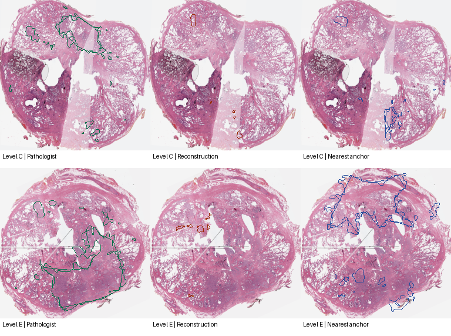

# TCIA prostate tumor extent

Open the volume explorer with `?dataset=tcia-prostate`. On B, D, F and G, gold shows the expert cancer contours used as anchors. On C and E, gold shows the prediction and cyan shows the withheld pathologist contour. Toggle either overlay to see the underlying H&E. The source readout maps the cursor to pixels in the original stitched TIFF.

## Held-out result

**The reconstructed tumor failed to localize the pathologist-marked extent on both withheld sections.** Mean Dice was 0.0046. Copying the nearest anchor scored 0.0529. These are two observations from one prostate.

| Level | Expert area (grid pixels) | Predicted area | Overlap | Predicted Dice | Nearest-anchor Dice |
| --- | ---: | ---: | ---: | ---: | ---: |
| C | 1,875 | 315 | 10 | 0.0091 | 0.0434 |
| E | 3,439 | 308 | 0 | 0.0000 | 0.0625 |

The distance interpolation shrank the predicted regions where the surrounding anchors disagreed. It missed 1,865 annotated grid pixels on C and all 3,439 on E. The nearest anchor also had poor spatial agreement. This experiment cannot isolate anatomical change from orientation, stitching and registration error. Independent intraprostatic landmark checks would help distinguish those explanations on a fresh case. Multifocal disease, sparse sampling and normalization by the organ bounding box are additional possible explanations. Testing any revised method requires a newly frozen, independent evaluation split. C and E are now known outcomes. [Pixel counts and prediction digest](scores.json) ? [Publisher checksums verified for the twelve inputs](input-md5.txt)

## Study design

Specimen aaa0051 has six ordered pseudo-whole-mount H&E sections, B–G. The source pathologist outlined cancer on the stitched slides. These annotations predate this analysis. The published correspondence table assigns them to T2 indices 17, 16, 15, 14, 13 and 12 respectively. These are sampled organ levels. The distance between native histological cuts is unverified. [Frozen split and endpoint](PROTOCOL.md) · [Collection and correspondence files](https://www.cancerimagingarchive.net/collection/prostate-fused-mri-pathology/)

For each H&E image the pipeline estimates an axis-aligned tissue bounding box from stained pixels, trims the outer 0.1 percent on each side and resamples to a square grid. It retains the slide's original orientation. It reads the native XY polygons in the CAP layer only. Contour interiors are filled under the even-odd rule to support holes. Some XML contours are marked NegativeROA even for isolated CAP regions. This analysis treats enclosed CAP regions as annotated tumor, with nesting determining holes. Atypia and PIN are separate layers and excluded.

At the two missing levels, the estimated boundary is the zero contour of the mean signed distance to the flanking outlines. This asks whether sparse expert contours and image-derived organ bounds recover extent at another sampled level. It leaves local deformation, movement of individual foci and cross-slide focus identity unresolved. A mesh connection across sampled levels cannot by itself establish contiguous disease. The viewer exaggerates depth and normalizes width and height separately. Physical tumor volume is unavailable in this frame.

## Reproduce

Use the TCIA collection's **Digitally Reconstructed Pseudo-whole-mount Sections** download. In its public Aspera package select the TIFF and XML for each of these six stems. Put the files anywhere under `data/tcia/files/`. Image and XML coordinates refer to the original package TIFFs.

~~~text
aaa 0051 BSlice
aaa 0051 C1C2C3C4
aaa 0051 D1D2D3D4_correction
aaa 0051 E1E2E3E4
aaa 0051 F1F2F3F4
aaa 0051 G1G2G3G4
~~~

~~~sh
python -m pip install -r requirements.txt tifffile imagecodecs
python -m scripts.tcia_prostate reconstruct
python -m scripts.tcia_prostate evaluate
~~~

The first command after installation generates the volume with only the four anchor XMLs present. The evaluation command requires the remaining two XMLs. It writes the reference overlay, per-level scores and a comparison figure. The SHA-256 in the scores identifies the exact volume evaluated.

## Attribution

Madabhushi, A., & Feldman, M. (2016). *Fused Radiology-Pathology Prostate Dataset (Prostate Fused-MRI-Pathology).* The Cancer Imaging Archive. This repository distributes cropped, downsampled H&E and rasterized or reconstructed contours derived from the original data under CC BY 3.0. [Dataset DOI](https://doi.org/10.7937/K9/TCIA.2016.TLPMR1AM) · [License](https://creativecommons.org/licenses/by/3.0/)
